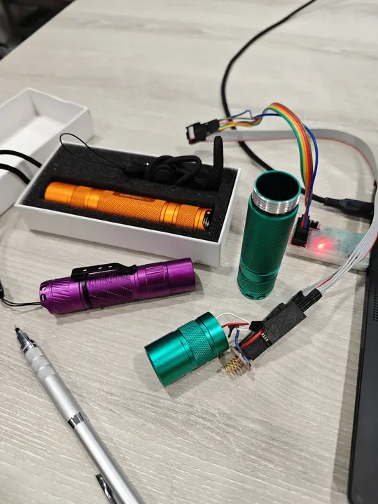
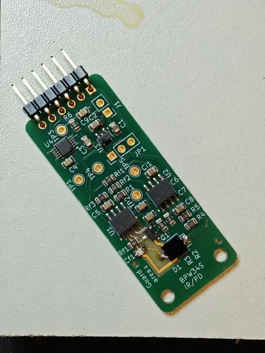

+++
title = "Breaking Touch-Free Exit Buttons - Project Trinfiltration"
date = 2026-11-12T01:26:40+00:00
+++

## or: Stop Putting Infrared Exit Buttons Behind Glass Doors

Since COVID and everyone becoming more averse to touching things, these touch-free exit buttons[^1] (left) have become more popular. 



They replace the conventional "green exit button" (right) as a way to unlock a magnetically/electrically locked door on your way out of a secure area. 

These touch-free exit buttons work by emitting a pulsed infrared signal and sensing reflections of that signal off your hand when you wave it near the sensor. The same principle is used by automatic taps, (some) hand dryers, and automatic toilet flushes. 

This infrared signal is light (fine, technically electromagnetic radiation). Glass is a material famously transparent to visible light, but often also transparent to infrared light. 

This means that someone (me) can shine pulsed infrared light through your glass door and trigger the touch-free exit button, as if I was someone trying to exit. If I match the signal exactly, the button does not know if what it's receiving is a reflection from a hand or an external source. So, the door unlocks and lets me in, without needing to even clone a keycard. 

All this exploit needs is a transparent light path into the room where the touch-free exit button is. This can be a glass door, nearby glass window, or even an under-door gap (in theory).

Listen for the "beep" of the door unlocking in this demo video (noting the lack of anything near the exit button).



# Background
When I initially spotted these infrared touch-free exit buttons I, like any good engineer, started theorising about how they worked. My theories were confirmed when I saw a unit with an unusually transparent front and identified an infrared LED and sensor next to each other inside. The sensor looked like the type to be found in a set-top-box or TV, to receive TV remote signals. I remember thinking, "Surely they've thought about the obvious vulnerability of sending an external signal through the glass. It can't possibly be that easy..."  

## It was that easy

I bought a unit to reverse-engineer and test on. The waveform looked exactly like the modulated waveform a TV remote would emit - a constant 38kHz square wave, except with no added modulation. This 38kHz frequency is the same used by TV remotes. 

I picked up a random LED strip remote lying around in my lab, pointed it at the test subject, and pressed a button. The exit button went green and clicked as if I had waved my hand near it. 

This only worked at short to medium distances pointed directly at the exit button because the IR LED in the remote was not very powerful. 

I had a concurrent interest in flashlights [r/flashlight] and so knew how to modify a off-the-shelf flashlight with an infrared LED and custom code to make it emit the 38kHz signal. After a little debugging (for some reason, infrared LEDs short their thermal pad to the anode...), I had a 3-ish watt infrared blaster. 

Now, I could trigger the touch-free exit button pointing my device anywhere in the same room, by the same principle that means you don't have to point a TV remote straight at the TV - the reflected IR light bouncing around the room was enough for the sensor to detect. 

I tried this in the real-world with the original exit button that inspired this whole project, and it worked flawlessly. I had to point it at the glass to transmit enough of the pulsed signal into the room where the exit button was, but it opened the door reliably.

(I had card access to both sides of this door anyway.)

## It's not that easy

After my initial success I went and looked for other infrared devices I could trick. 

I found a few similar looking exit buttons that refused to be fooled by my new device. But I also noticed that many automatic gate sensors could be fooled into thinking that they were obstructed (they use infrared beams to detect objects blocking the gate from closing). In fact, my luck was quite bad - only the original specimen would respond to my spoofed signal, no other exit buttons showed any response. 

This led to a tangent of building a photodiode sensing device to observe what waveform these "hardened" exit buttons were emitting. 

It used the same 38kHz square wave modulation as the "easy to break" ones, but also pulsed this modulated wave. My theory was that if it detected a received signal when it itself was not transmitting a signal, it would assume shenanigans and refuse to unlock. Essentially, checking for absence as well as presence[^2]. 

I bought one of these units too and confirmed my suspicions. Unlike the first test unit which had a simple dual-555-timer analog circuit to generate and detect the signal, this one had just one mysterious unmarked 8-pin chip - suspected to be a microcontroller given its pins and function. (Current guess is a PIC18F type chip.) 

If my theory is correct, then it creates the harder problem of synchronising my pulsed signal to the exit button's own pulsed signal to trick it successfully. I am building an FPGA-based sensing platform to do this "replay attack" automatically. Let's call it a "Versatile Infrarekt Device" (below)

This project is shelved for now, but when I work on it again I plan to connect a USB-controlled infrared light (i.e. Raspberry Pi Pico with IR LED) and signal analyser to the mystery 8-pin chip, and let Codex / Claude try and decode the internal logic inside and unlock the virtual door. 

Let me know if you like my AI-less writing style. 

## Footnotes

[^1]: Pedantry: the touch-free exit button is more of a sensor, as you do not press it, but "button" intuitively describes its purpose.

[^2]: After finishing my prototype, I researched this idea to see if anyone had come up with it before me. I found [Michael Rodger's writeup](https://sensepost.com/blog/2025/noooooooooo-touch/) , and he actually managed to get past the "pulsed signal" problem. And yet these things keep being installed. 
